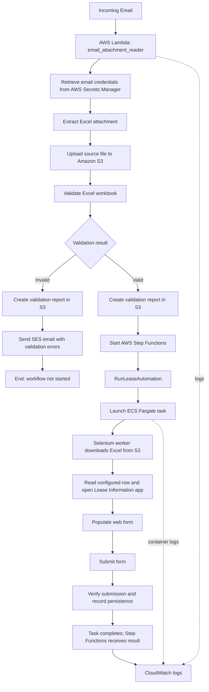

# Lease Information Automation
## Technical Architecture & Implementation Documentation

**Documentation date:** 16 November 2026  
**AWS account:** 347282156187  
**AWS Region:** ap-southeast-2 (Asia Pacific — Sydney)  
**Status:** Core email processing and AWS workflow orchestration tested. Selenium form submission and record persistence remain to be verified.

> The current email integration uses a Gmail client. “Email” is used as the business-level term throughout; this does not imply multiple email providers are integrated. This document records verified implementation details and distinguishes outstanding work.

## 1. Project overview

The solution receives Excel attachments through email, stores and validates them, and starts browser automation for valid attachments.

**Processing flow:** Email → AWS Lambda → Amazon S3 → Excel validation → AWS Step Functions → Amazon ECS Fargate → Selenium worker → Lease Information application.

### End-to-end flow diagram

**Important:** The invalid-file notification branch and the valid-file orchestration branch are verified by the recorded integration test. The final Selenium submission and persistence steps are shown as the intended worker flow; their business-level success is still pending verification.

- **Valid attachment:** source file and validation report are stored in S3; Step Functions is started.
- **Invalid attachment:** source file and validation report are stored in S3; an SES notification is sent to the captured sender; Step Functions is not started.

## 2. Architecture components

| Component | Responsibility |
|---|---|
| Email | Receives Excel attachments from requestors. |
| AWS Lambda | Finds matching unread messages, extracts attachments, coordinates validation, and starts the workflow for valid files. |
| AWS Secrets Manager | Stores email authentication credentials. |
| Amazon S3 | Stores source Excel files and validation reports. |
| Excel validator | Checks workbook contents against configured validation rules. |
| Amazon SES | Sends validation error notifications. |
| AWS Step Functions | Orchestrates the on-demand ECS task and waits for completion. |
| Amazon ECS Fargate | Runs the Selenium worker on demand. |
| Amazon ECR | Stores the Selenium worker container image. |
| Amazon CloudWatch | Stores Lambda and ECS logs. |
| React + Vite | Implements the Lease Information web application. |
| Amazon S3 + CloudFront | Hosts and distributes the frontend application. |

## 3. AWS environment and resources

### 3.1 Account and region

| Property | Value |
|---|---|
| AWS account ID | 347282156187 |
| Region | ap-southeast-2 |
| Region name | Asia Pacific (Sydney) |

### 3.2 Frontend application

| Property | Value |
|---|---|
| Framework | React |
| Build tool | Vite |
| Hosting | Amazon S3 |
| Content delivery | Amazon CloudFront |
| Application URL | https://d2o76zyt1pudn4.cloudfront.net |

### 3.3 Amazon S3

| Property | Value |
|---|---|
| Bucket | employee-excel-attachments-20261103-4827 |
| Source attachment prefix | incoming/ |
| Validation report prefix | validation-reports/ |

Example source object: `incoming/1a1e4951725f8e8e/1_lease_slan_template_replica_latest.xlsx`

Example validation report: `validation-reports/1a1e4951725f8e8e/lease_slan_template_replica_latest.xlsx.validation.json`

### 3.4 AWS Lambda

| Property | Value |
|---|---|
| Function | email_attachment_reader |
| Runtime | Python |
| Memory allocation | 512 MB |
| Observed execution duration | 4.609 seconds |
| Observed maximum memory used | 111 MB |

Responsibilities:
- Load application settings.
- Retrieve email authentication credentials from Secrets Manager.
- Search unread messages matching the configured subject.
- Capture sender details and extract Excel attachments.
- Upload source attachments to S3 and validate workbooks.
- Send SES notifications for invalid files.
- Upload validation reports.
- Start Step Functions for valid attachments.

### 3.5 AWS Step Functions

| Property | Value |
|---|---|
| State machine | lease-form-automation-workflow |
| Workflow type | Standard |
| ECS integration | ecs:runTask.sync |
| State machine ARN | arn:aws:states:ap-southeast-2:347282156187:stateMachine:lease-form-automation-workflow |

### 3.6 Amazon ECS Fargate

| Property | Value |
|---|---|
| Cluster | lease-automation-cluster |
| Task definition family | lease-automation-task |
| Task definition revision used | 3 |
| Container name | lease-form-automation |
| Launch type | Fargate |
| CPU | 1024 |
| Memory | 2048 MB |
| Operating system | Linux |
| Architecture | X86_64 |
| Network mode | awsvpc |
| CloudWatch log group | /ecs/lease-automation |

The task is launched on demand by Step Functions. An always-running ECS service is not required for the current design.

### 3.7 Amazon ECR

| Property | Value |
|---|---|
| Repository | lease-form-automstion |
| Image tag recorded for deployment | dae54531fdc56127993bf0f3d2a2451f7491ff32 |
| Image URI | 347282156187.dkr.ecr.ap-southeast-2.amazonaws.com/lease-form-automstion:dae54531fdc56127993bf0f3d2a2451f7491ff32 |
| Image digest | sha256:4d2fcb8ea28db92f7906bc594e40b090390c4820fbd7a3d36c03730986af6b0f |

The container image interface was verified to accept the Excel path, S3 bucket, S3 object key, and row selection arguments.

### 3.8 Network configuration used by the tested task

| Property | Value |
|---|---|
| VPC | vpc-09dccdf1bff42789f |
| Subnet | subnet-092d703656c0e4707 |
| Security group | sg-064fd81f95e119396 |
| Public IP assignment | Enabled |
| Outbound rule | 0.0.0.0/0 |

This records the configuration used for the tested workflow; it is not a security assessment or production network recommendation.

## 4. Application configuration

### 4.1 ECS environment variables

| Variable | Configured value |
|---|---|
| FORM_URL | https://d2o76zyt1pudn4.cloudfront.net |
| SCREENSHOT_DIR | /tmp/screenshots |
| PAGE_LOAD_TIMEOUT | 30 |
| HEADLESS | true |
| LOG_DIR | /tmp/logs |
| WAIT_TIMEOUT | 20 |

### 4.2 Lambda configuration

The Lambda uses environment-based application settings. The state machine ARN is supplied through `STEP_FUNCTIONS_STATE_MACHINE_ARN`. Other settings include the email secret name, expected email subject, S3 bucket and prefix, Excel validation rules location, SES sender email, and AWS region.

Sensitive credentials and tokens must remain in Secrets Manager or another approved protected configuration. They must not be committed to source control or included in project documentation.

## 5. Email processing and validation

### 5.1 Processing sequence

1. Load application settings.
2. Retrieve email credentials from Secrets Manager.
3. Initialize the email, S3, Excel validation, and SES integrations.
4. Obtain an email access token and search for unread matching messages.
5. Process each matching message and capture the sender address.
6. Extract Excel attachments and upload them to S3.
7. Validate each workbook against configured rules.
8. Handle the validation outcome.
9. Upload the validation report and record the processing result.

### 5.2 Invalid attachment handling

For an attachment with status `INVALID`:
- Step Functions is not started.
- An SES notification is sent to the captured sender address and includes the validation errors.
- The validation report is uploaded to S3.
- The SES message ID is recorded in the Lambda response.

### 5.3 Valid attachment handling

For an attachment with status `VALID`:
- The validation report is uploaded to S3.
- A Step Functions execution is started.
- The S3 bucket and object key are passed to the workflow.
- The execution ARN is recorded in the Lambda response.

The current workflow is configured to process Excel row 2.

## 6. Step Functions and ECS workflow

The state machine contains a task state named `RunLeaseAutomation` and uses the ECS synchronous run-task integration.

1. Receive the S3 bucket and object key.
2. Start an ECS Fargate task using the configured cluster.
3. Use task definition revision 3.
4. Apply the configured Fargate network settings.
5. Pass the S3 location and row selection to the container.
6. Wait for the ECS task to finish.
7. Return the workflow outcome.

A successful Step Functions execution confirms that the workflow completed successfully. It does not, by itself, prove that the web form was submitted or that the record was persisted.

## 7. IAM roles and permissions

### 7.1 Step Functions execution role

The Step Functions execution role is `StepFunctionsPowerUserRole-1`. An inline `iam:PassRole` permission was added for the ECS roles below, restricted to the ECS tasks service:
- `ecsTaskExecutionRole`
- `leaseAutomationTaskRole`

### 7.2 Lambda execution role

The Lambda execution role was granted `states:StartExecution` permission scoped to the `lease-form-automation-workflow` state machine. The Lambda also uses permissions for its existing integrations, including Secrets Manager, S3, CloudWatch Logs, and SES.

### 7.3 ECS roles

| Role | Purpose |
|---|---|
| ecsTaskExecutionRole | ECS task execution operations, including image retrieval and log delivery. |
| leaseAutomationTaskRole | Application-level AWS permissions required by the worker, including access to the source object in S3. |

IAM permissions should be reviewed periodically and restricted to the minimum required actions and resources.

## 8. Source repository and deployment

**Repository:** https://github.com/sandeepKotha1984/employee-form-automstion

Deployment sequence:
1. Commit application changes to the repository.
2. Trigger the GitHub-based container build workflow.
3. Build the Selenium worker image.
4. Publish the image to Amazon ECR.
5. Update the ECS task definition when a new image revision is required.
6. Run the Step Functions workflow.

The tested task definition revision is 3. The image tag and digest above identify the image used in the recorded test.

## 9. Testing and execution evidence

### 9.1 ECS task test

The ECS task was manually tested using an existing Excel object in S3. The worker interface was verified to accept the S3 bucket, S3 key, and row selection. The task was launched successfully.

### 9.2 Manual Step Functions test

The state machine was manually executed with an S3 bucket and object key as input. The manual workflow execution succeeded.

### 9.3 Lambda integration test — 16 November 2026

Test event: `gmail_secret_test`

| Metric | Observed result |
|---|---:|
| Lambda status | Succeeded |
| Emails processed | 2 |
| Attachments uploaded | 2 |
| Valid attachments | 1 |
| Invalid attachments | 1 |

**Valid attachment**

| Property | Observed result |
|---|---|
| Filename | lease_slan_template_replica_latest.xlsx |
| Validation status | VALID |
| Validation errors | 0 |
| File size | 10,822 bytes |
| S3 upload | Successful |
| Step Functions start | Successful |

**Invalid attachment**

| Property | Observed result |
|---|---|
| Filename | lease_slan_template_replica_latest (1).xlsx |
| Validation status | INVALID |
| Validation errors | 11 |
| File size | 10,946 bytes |
| S3 upload | Successful |
| SES notification | Sent |
| Step Functions start | Not performed |

These results confirm the validation branching for the two attachments in this test.

### 9.4 Lambda execution metrics

| Metric | Observed value |
|---|---:|
| Duration | 4,608.57 ms |
| Billed duration | 4,609 ms |
| Allocated memory | 512 MB |
| Maximum memory used | 111 MB |

### 9.5 Step Functions execution result

| Property | Observed value |
|---|---|
| Execution name | lease-3f8c3e8325d207044ca04095396951b2 |
| Execution status | SUCCEEDED |
| Start time (local) | 16 November 2026, 19:09:30 |
| End time (local) | 16 November 2026, 19:10:28 |
| Duration | 57.873 seconds |
| Execution ARN | arn:aws:states:ap-southeast-2:347282156187:execution:lease-form-automation-workflow:lease-3f8c3e8325d207044ca04095396951b2 |

The Lambda logs confirmed that the valid attachment passed validation and that Step Functions was started. The invalid attachment generated an SES notification and did not start the workflow.

## 10. Implementation status

| Component | Status |
|---|---|
| React Lease Information application | Hosted |
| S3 frontend hosting | Configured |
| CloudFront distribution | Configured |
| Email processing | Tested successfully |
| Secrets Manager integration | Tested successfully |
| Attachment extraction | Tested successfully |
| S3 attachment upload | Tested successfully |
| Excel validation | Tested successfully |
| SES invalid-file notification | Tested successfully |
| Validation report upload | Tested successfully |
| Lambda to Step Functions | Tested successfully |
| Step Functions to ECS Fargate | Tested successfully |
| ECS task completion | Workflow succeeded |
| Selenium business-level form submission | Pending verification |
| Submitted record persistence | Pending verification |

## 11. Remaining work

### 11.1 Verify Selenium form submission

The ECS task and Step Functions execution completed successfully. However, the available test evidence does not independently establish that the Lease Information form was submitted or that the record was saved.

Verification checklist:
1. Inspect the ECS CloudWatch log stream for the execution.
2. Confirm that the worker downloaded the expected Excel object.
3. Confirm that the expected Excel row was read.
4. Confirm that the form fields were populated correctly.
5. Confirm that the Submit action was triggered.
6. Confirm that the application displayed a submission-success response.
7. Verify that the submitted record was persisted in the application.
8. Distinguish a successful Reset operation from a successful Submit operation.

### 11.2 Reliability enhancements

- Explicit form submission verification.
- Screenshot capture after submission.
- Structured Selenium error reporting.
- Retry handling for transient failures.
- Browser and driver cleanup.
- Clear failure reporting to the initiating sender.
- Duplicate execution protection.
- Separate business-level success reporting.

### 11.3 Production-readiness improvements

- CloudWatch alarms and monitoring.
- Failure handling and recovery strategy.
- Execution audit records.
- Automated integration tests.
- Least-privilege IAM review.
- S3 encryption, access, and retention review.
- Operational dashboards.
- Testing multiple attachments and larger Excel files.
- Concurrent execution and duplicate-email testing.

These reliability and production-readiness items are proposed improvements, not features confirmed as implemented.

## 12. Operational and security notes

1. Do not hardcode credentials or access tokens in application files.
2. Store sensitive credentials in AWS Secrets Manager.
3. Restrict IAM permissions to the resources required by each component.
4. Keep the container image architecture compatible with the Fargate task configuration.
5. Pass the exact S3 bucket and object key through Step Functions.
6. Retain CloudWatch logs and execution details for troubleshooting.
7. Treat workflow completion and successful form submission as separate outcomes.
8. Review S3 access controls and retention policies before production deployment.

## 13. Summary

The core email-processing and AWS orchestration pipeline has been implemented and tested.

The 16 November 2026 integration test processed two emails and two Excel attachments. One attachment passed validation; the other failed validation with 11 errors and generated an SES notification. Step Functions started only for the valid attachment, and the workflow completed successfully in 57.873 seconds.

**Current conclusion:** Email processing, validation, storage, notification, and AWS workflow orchestration have been verified. Selenium form submission and record persistence remain the next validation milestones.
